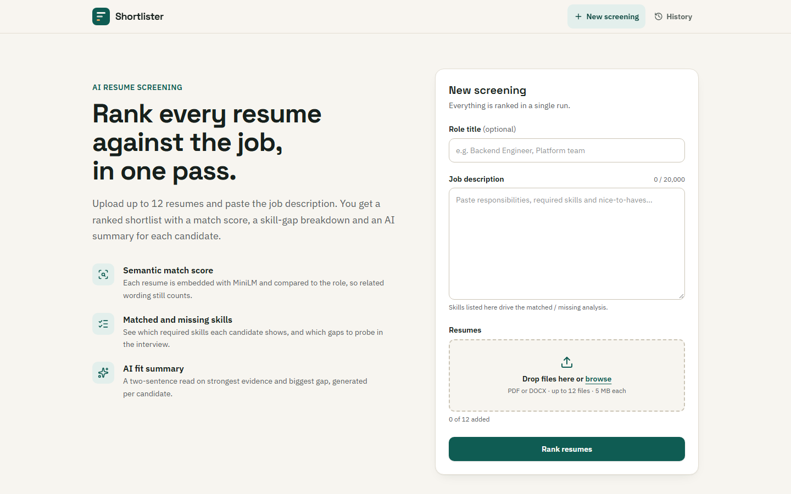
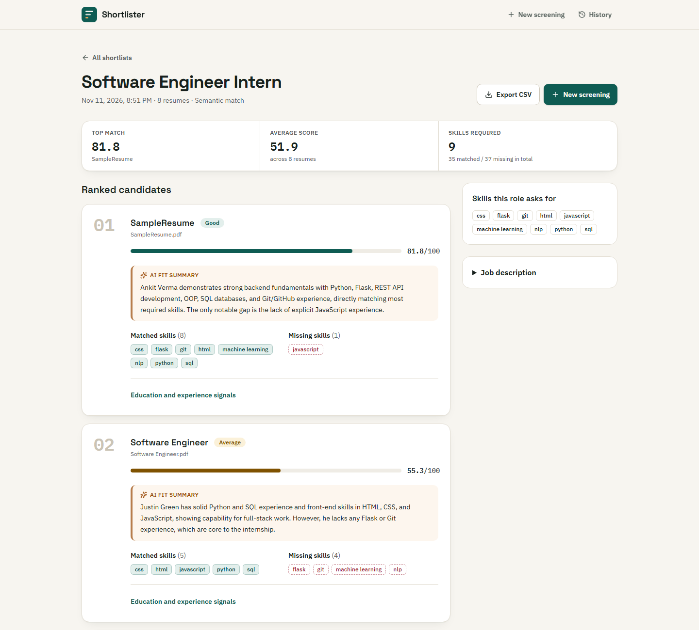
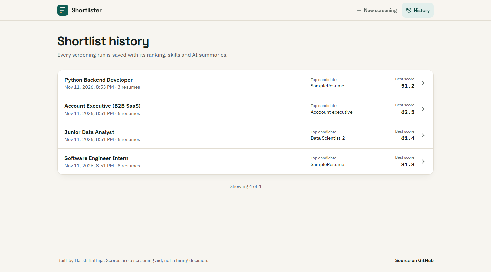
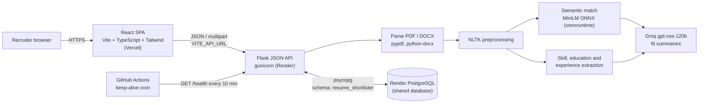

# Resume Shortlister

**Upload a stack of resumes and a job description, get back a ranked shortlist with semantic match scores, matched and missing skills, and an AI fit summary for every candidate.**

[](https://github.com/HarshBathija-04/AI-Resume-Shortlister/actions/workflows/ci.yml)

| | |
| --- | --- |
| Live demo | `https://<your-app>.vercel.app` *(placeholder, set after the first Vercel deploy)* |
| API | `https://<your-api>.onrender.com/health` *(placeholder, set after the first Render deploy)* |

The API runs on Render's free tier, which sleeps after 15 minutes idle. The first request can take 30 to 60 seconds; the UI shows a "waking up the server" notice while that happens.

## Features

- **Batch screening.** Drop up to 12 PDF or DOCX resumes (5 MB each) and paste the job description.
- **Semantic match score.** Every resume is embedded with `all-MiniLM-L6-v2` and compared to the job description by cosine similarity, so related wording still counts. A TF-IDF mode is available too.
- **Skill-gap analysis.** Shows the tracked skills the role asks for and, per candidate, which are present and which are missing.
- **AI fit summary.** Groq (`openai/gpt-oss-120b`) writes a two-sentence read per candidate: strongest evidence first, then the biggest gap. If Groq is rate limited or down, the run still completes and the summary is marked unavailable.
- **Education and experience signals** pulled out of each resume.
- **Run history.** Every run is stored in Postgres and can be reopened or exported to CSV.
- **Production basics.** Pydantic validation, consistent JSON errors, CORS allow-list, rate limits, security headers, and a `/health` check that queries the database.

## Screenshots

| Upload | Ranked results | History |
| --- | --- | --- |
|  |  |  |

## Architecture



**Request flow for a new run:** the frontend posts multipart form data to `POST /api/runs`. The API validates it, extracts text, ranks every resume against the job, asks Groq for all summaries in a single batched call, then stores the run and its ranked results in one transaction and returns them.

**Why ONNX instead of sentence-transformers:** the original app loaded the same MiniLM model through PyTorch, which needs about 1 GB of RAM. The quantized ONNX export of that model adds about 60 MB, so semantic matching fits inside Render's 512 MB free instance. Quantization shifts individual scores by a few points (up to about 6 on the bundled samples) but keeps the same top candidate.

## Tech stack

| Layer | Tools |
| --- | --- |
| Frontend | React 19, TypeScript, Vite, Tailwind CSS v4, React Router, sonner (toasts), lucide icons |
| Backend | Python 3.13, Flask 3, gunicorn, Pydantic 2, Flask-Limiter, Flask-CORS |
| Matching | onnxruntime + tokenizers (MiniLM), scikit-learn (TF-IDF), NLTK |
| AI | Groq Python SDK, `openai/gpt-oss-120b` |
| Data | PostgreSQL via psycopg 3, plain SQL migrations |
| Quality | pytest, ruff, vitest, oxlint, prettier, GitHub Actions |
| Hosting | Vercel (frontend), Render web service and PostgreSQL (API, DB) |

## Local setup

Prerequisites: Python 3.13, Node 24 or newer, and a PostgreSQL database (Docker works fine).

```bash
# 0. Postgres (skip if you already have one)
docker run -d --name portfolio-pg -p 5433:5432 -e POSTGRES_PASSWORD=postgres -e POSTGRES_DB=portfolio postgres:16

# 1. Backend
cd backend
python -m venv .venv
source .venv/bin/activate            # Windows: .venv\Scripts\activate
pip install -r requirements-dev.txt
cp .env.example .env                 # then set GROQ_API_KEY
python -m nltk.downloader -d ./nltk_data punkt punkt_tab stopwords wordnet omw-1.4
python seed.py                       # runs migrations and inserts 3 demo runs (idempotent)
flask --app app run --port 5100

# 2. Frontend (new terminal)
cd frontend
npm install
cp .env.example .env                 # VITE_API_URL=http://localhost:5100
npm run dev                          # http://localhost:5200
```

The MiniLM model (about 23 MB) is downloaded into `backend/models/` on first use.

### Tests and linters

```bash
cd backend && pytest && ruff check . && ruff format --check .
cd frontend && npm run lint && npm run format:check && npm test && npm run build
```

Backend tests use their own schema (`resume_shortlister_test`) and never call Groq.

### Offline evaluation

`backend/evaluation.py` measures precision and recall of the ranking against a labelled CSV:

```bash
python evaluation.py --job job.txt --resumes sample_resumes --labels labels.csv --method semantic --threshold 50
```

## API

| Method | Path | Description |
| --- | --- | --- |
| `GET` | `/health` | `{"status":"ok","db":"ok"}`, or 503 with `db: "error"` |
| `GET` | `/api/runs?limit=20&offset=0` | Run history, newest first |
| `POST` | `/api/runs` | Create a run. Multipart (`title`, `job_description`, `resumes[]`) or JSON (`{title, job_description, resumes: [{filename, text}]}`). Limited to 5 per minute per IP. |
| `GET` | `/api/runs/:id` | One run with its ranked results |
| `GET` | `/api/runs/:id/results.csv` | CSV export |

Errors always look like `{"error": {"code": "validation_error", "message": "...", "details": [...]}}`.

## Environment variables

### Backend (`backend/.env`)

| Variable | Required | Default | Description |
| --- | --- | --- | --- |
| `DATABASE_URL` | yes | none | Postgres connection string |
| `DB_SCHEMA` | no | `resume_shortlister` | Schema that holds this app's tables (created automatically) |
| `FRONTEND_URL` | yes in prod | `http://localhost:5200` | Allowed CORS origins, comma-separated |
| `GROQ_API_KEY` | no | none | Enables AI fit summaries. Without it, runs still work. |
| `MATCH_METHOD` | no | `semantic` | `semantic` (MiniLM) or `tfidf` |
| `NLTK_DATA` | no | NLTK default | Folder holding the NLTK corpora |
| `MODEL_DIR` | no | `backend/models/all-MiniLM-L6-v2` | Where the ONNX model is stored |

### Frontend (`frontend/.env`)

| Variable | Required | Description |
| --- | --- | --- |
| `VITE_API_URL` | yes | Base URL of the API, for example `https://resume-shortlister-api.onrender.com` |

## Deployment

### 1. Database (one-time, shared)

All portfolio apps share one Render PostgreSQL instance; this app keeps its tables in the `resume_shortlister` schema. Create the database once in the Render dashboard if it does not exist yet, and copy its **Internal Database URL**.

### 2. API on Render

1. In Render choose **New > Blueprint** and select this repository. Render reads `render.yaml` and creates the `resume-shortlister-api` web service (root directory `backend`).
2. When prompted, set:
   - `DATABASE_URL`: the shared database's internal URL
   - `GROQ_API_KEY`: your Groq key
   - `FRONTEND_URL`: your Vercel URL (add it after step 3 if you do not know it yet)
3. Deploy. The start command runs migrations and the idempotent seed, then starts gunicorn. Check `https://<service>.onrender.com/health`.

### 3. Frontend on Vercel

1. **Add New > Project**, import this repository, and set **Root Directory** to `frontend` (Vite is detected automatically).
2. Add the environment variable `VITE_API_URL` pointing to the Render URL.
3. Deploy. `vercel.json` rewrites every path to `index.html` so deep links such as `/runs/1` work.
4. Put the Vercel URL into the Render service's `FRONTEND_URL` and redeploy the API.

### 4. Keep-alive

`.github/workflows/keep-alive.yml` pings `/health` every 10 minutes so the free Render service (and its database connection) stays warm. Under **Settings > Secrets and variables > Actions > Variables**, add a repository variable `BACKEND_URL` set to the Render URL. Without it, the workflow skips with a notice.

## Project structure

```
.
├── backend/
│   ├── app.py              # Flask app: routes, validation, errors, CORS, rate limits, headers
│   ├── shortlist.py        # Ranking pipeline and run persistence
│   ├── matcher.py          # Skill/education/experience extraction, TF-IDF and MiniLM scoring
│   ├── nlp_utils.py        # NLTK preprocessing
│   ├── resume_parser.py    # PDF and DOCX text extraction
│   ├── ai.py               # Groq fit summaries with graceful fallback
│   ├── db.py               # Connections pinned to DB_SCHEMA, migration runner
│   ├── migrations/         # Plain SQL migrations
│   ├── seed.py             # Idempotent demo data from sample_resumes/
│   ├── evaluation.py       # Offline precision/recall script
│   ├── sample_resumes/     # Demo resumes and a sample job description
│   └── tests/              # pytest suite
├── frontend/
│   ├── src/components/     # Layout, upload form, run list, UI primitives
│   ├── src/pages/          # Home, run results, history, 404
│   ├── src/lib/            # API client, cold-start detection, validation, formatting
│   └── vercel.json
├── docs/screenshots/
├── render.yaml             # Render Blueprint for the API
└── .github/workflows/      # CI and keep-alive
```

## Notes and limits

- Uploaded files are parsed in memory and never stored. Only the filename, scores, skills, extracted education and experience lines, and the AI summary are saved.
- The demo has no login, so anyone with the URL can see the run history. Do not upload real candidates' resumes to the public demo.
- Skill detection uses a fixed list of about 30 technical skills (see `SKILLS` in `matcher.py`). Non-technical roles therefore rely on the semantic score and the AI summary.
- Scores are a screening aid, not a hiring decision.

## Author

Built by **Harsh Bathija** ([@HarshBathija-04](https://github.com/HarshBathija-04)).
